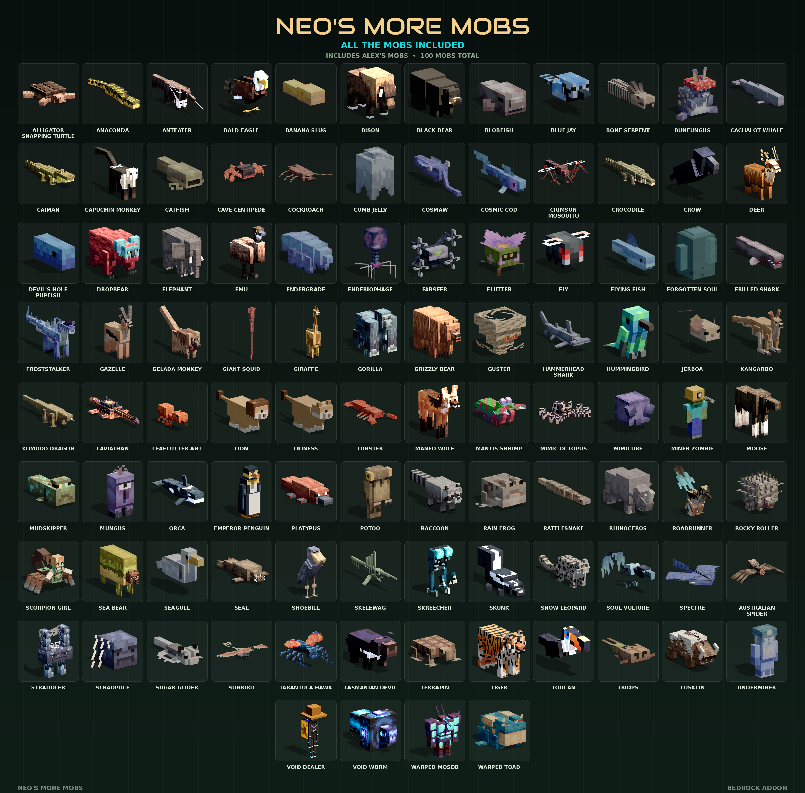

# Neo's More Mobs

**100 mobs for Minecraft Bedrock Edition** - the complete [Alex's Mobs](https://github.com/AlexModGuy/AlexsMobs) 1.22.9 port plus Neo's original mobs, merged into one addon. Duplicates removed, so every mob appears exactly once.



## Download

Grab `pack/NeosMoreMobsUnified.mcaddon` and open it with Minecraft (Bedrock 1.26.10 or newer). Both packs install at once.

Manual install: copy `NeosMoreMobsUnified_BP` into `behavior_packs` and `NeosMoreMobsUnified_RP` into `resource_packs`, then enable both on your world.

## What's inside

- 100 entities with models, textures, animations, spawn rules, loot tables and spawn eggs.
- Behaviour pack: entities, spawn rules, loot, recipes, features, graveyard structures, trader scripts.
- Resource pack: Bedrock geometry, animations, animation controllers, render controllers and textures.
- Spawn eggs for every mob, named in `texts/en_US.lang`.

<details>
<summary>All 100 mobs</summary>

Alligator Snapping Turtle · Anaconda · Anteater · Bald Eagle · Banana Slug · Bison · Black Bear · Blobfish · Blue Jay · Bone Serpent · Bunfungus · Cachalot Whale · Caiman · Capuchin Monkey · Catfish · Cave Centipede · Cockroach · Comb Jelly · Cosmaw · Cosmic Cod · Crimson Mosquito · Crocodile · Crow · Deer · Devil's Hole Pupfish · Dropbear · Elephant · Emu · Endergrade · Enderiophage · Farseer · Flutter · Fly · Flying Fish · Forgotten Soul · Frilled Shark · Froststalker · Gazelle · Gelada Monkey · Giant Squid · Giraffe · Gorilla · Grizzly Bear · Guster · Hammerhead Shark · Hummingbird · Jerboa · Kangaroo · Komodo Dragon · Laviathan · Leafcutter Ant · Lion · Lioness · Lobster · Maned Wolf · Mantis Shrimp · Mimic Octopus · Mimicube · Miner Zombie · Moose · Mudskipper · Mungus · Orca · Emperor Penguin · Platypus · Potoo · Raccoon · Rain Frog · Rattlesnake · Rhinoceros · Roadrunner · Rocky Roller · Scorpion Girl · Sea Bear · Seagull · Seal · Shoebill · Skelewag · Skreecher · Skunk · Snow Leopard · Soul Vulture · Spectre · Australian Spider · Straddler · Stradpole · Sugar Glider · Sunbird · Tarantula Hawk · Tasmanian Devil · Terrapin · Tiger · Toucan · Triops · Tusklin · Underminer · Void Dealer · Void Worm · Warped Mosco · Warped Toad

</details>

## Repository layout

```
pack/    the addon - behaviour pack, resource pack and the built .mcaddon
docs/    posters rendered from the pack's own models
tools/   Python build and check scripts that assemble the packs
```

## Building from source

The packs are plain JSON, so they can be edited directly. The `tools/` scripts are what generated them:

- `merge_unified.py` - merges the Alex's Mobs port with Neo's original mobs, drops duplicates and rebuilds the combined license.
- `build_more_mobs.py`, `build_imported.py`, `build.py` - build the Neo mobs, the imported models and the original pack.
- `check_unified.py`, `check_addon.py`, `check_biomes.py` - validation gates.

They were written against the original authoring tree and use absolute paths at the top of each file, so point those at your checkout before running.

## License

This project is shared openly, with third-party work kept under its own license:

| Part | License |
| --- | --- |
| Code and data - behaviour JSON, entity JSON, spawn rules, loot, recipes, structures, build scripts | **MIT** - use it for anything, including commercial projects |
| Neo's models, textures, animations, renders and posters | **Neo's Art License 1.0** - free to use, remix and redistribute; no selling, no ad-gates, max one ad per download project |
| Alex's Mobs 1.22.9 / Citadel port | **LGPL-3.0-or-later** |
| Third-party models (elephant, bison, deer, whale, comb jelly, scorpion girl, Australia set) | **CC BY 4.0** |
| Grizzly Bear / Black Bear model | **CC BY-NC 4.0** |

Read [LICENSE.txt](LICENSE.txt) for the full grant and [CREDITS.txt](CREDITS.txt) for every third-party author with source links and a list of changes.

### Neo's Art License 1.0 in short

**You can** use, edit, retexture, re-rig, re-animate and redistribute the models, textures and animations in any free addon, mod, pack, map or video.

**You must** credit *Neo (NeoPhinixMC)* with the three links below, link the license, keep the license on anything you make from it, and say what you changed.

**You can't** sell the artwork or sell access to it (paid packs, Patreon/Ko-fi/Boosty gates, "donate to download"), put it behind an ad-wall or ad-shortener (adf.ly, linkvertise, ouo.io and friends), or upload it to ad-revenue mirror farms and server-list scrapers.

**Ads:** a free project may carry **one advertisement per download project** - one banner or one ad slot on the project or download page. Never an ad that gates or delays the download.

**Note:** the Grizzly Bear and Black Bear models are CC BY-NC 4.0, and Neo's artwork is non-commercial on its own terms, so the addon as distributed must not be sold.

## Crediting this project

Copy this into your credits as-is:

```
Neo's More Mobs by Neo (NeoPhinixMC)
GitHub:     https://github.com/BluePhinix/NeosMoreMobs
CurseForge: https://www.curseforge.com/members/neophinix
YouTube:    https://youtube.com/@neophinixmc
License:    Neo's Art License 1.0 (see LICENSE.txt)
```

One-liner version for a single-line credit field:

```
Neo's More Mobs by Neo (NeoPhinixMC) - https://github.com/BluePhinix/NeosMoreMobs - https://www.curseforge.com/members/neophinix - https://youtube.com/@neophinixmc
```

## Credits

- [Alex's Mobs](https://github.com/AlexModGuy/AlexsMobs) and [Citadel](https://github.com/AlexModGuy/Citadel) by AlexModGuy and contributors (LGPL-3.0) - the mobs, models, textures and animations this port is built from.
- ContinuedOak, mrhurr2859, Bada, Treeminator, Catnim and Whateverdata55 for the third-party models listed in [CREDITS.txt](CREDITS.txt).
- Neo (NeoPhinixMC) - port, original mobs, animations and tooling. [GitHub](https://github.com/BluePhinix/NeosMoreMobs) · [CurseForge](https://www.curseforge.com/members/neophinix) · [YouTube](https://youtube.com/@neophinixmc)

Not affiliated with Mojang or Microsoft.
